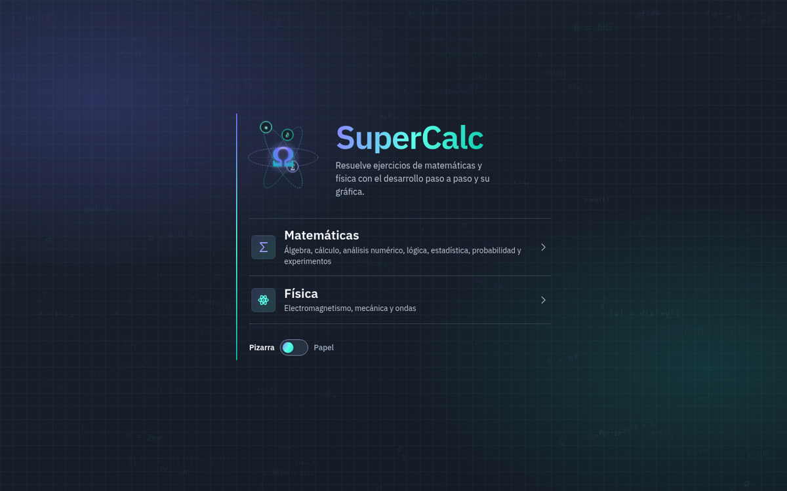
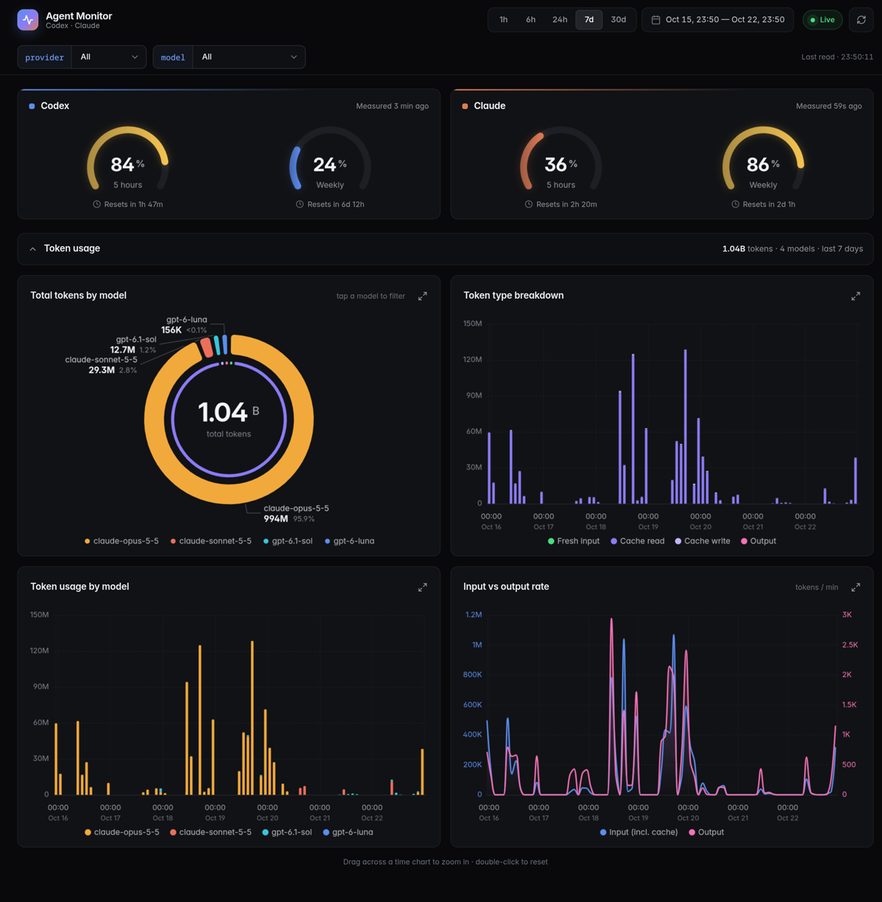
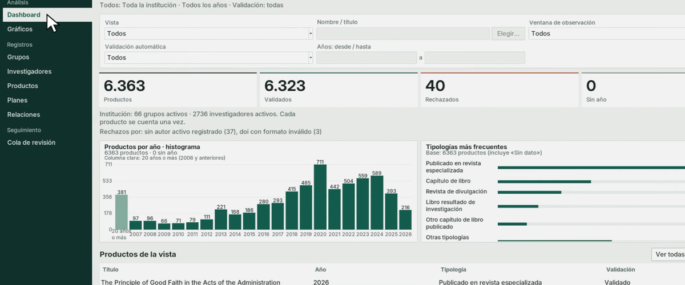
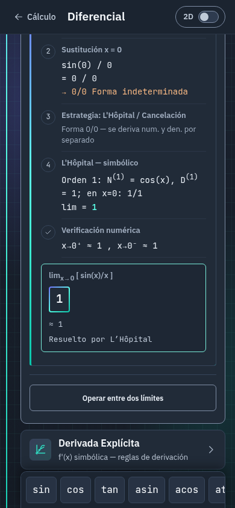

<h1 align="center">Hi, I'm Rafael Miranda 👋</h1>

  <strong>Systems Engineering student in Colombia.</strong> 
  I build math tools, data apps and developer dashboards.

  
  

---

### About me

- 🎓 Systems Engineering at the **Universidad Popular del Cesar**.
- 🧮 Building **SuperCalc**, a math and physics app that shows every step of the solution.
- 📊 Building data tools: research analytics with **PEA-i** and usage dashboards with **Agent Monitor**.
- 🧪 My projects ship with tests and documentation: SuperCalc alone runs over 900 tests.

### Tech I work with

  
  
  
  
  
  
  
  
  
  
  
  
  

### Featured projects

<table>
  <tr>
    <td width="55%">
      
    </td>
    <td>
      <h3><a href="https://github.com/nxmxl3zz/SuperCalc">SuperCalc</a></h3>
      A scientific calculator and math visualization app. It solves algebra, calculus, statistics, numerical analysis, logic and physics exercises with the full step-by-step working and a graph.
        
      Installable and offline-ready, with no framework and no dependencies, and backed by over 900 tests.
        
      
      
        
      <a href="https://supercalc-sooty.vercel.app"><strong>Open the app →</strong></a>
    </td>
  </tr>
  <tr>
    <td width="55%">
      
    </td>
    <td>
      <h3><a href="https://github.com/nxmxl3zz/agent-monitor">Agent Monitor</a></h3>
      A live dashboard for Codex and Claude Code subscriptions: quota gauges, token usage by model and cache, and agent sessions, in the terminal and on your phone.
        
      Phone access runs through a private Tailscale network that a built-in installer sets up.
        
      
      
      
    </td>
  </tr>
  <tr>
    <td width="55%">
      
    </td>
    <td>
      <h3><a href="https://github.com/nxmxl3zz/pea-i-upc">PEA-i UPC</a></h3>
      A research output manager for the Universidad Popular del Cesar: groups, researchers and products, automatic validation, a review queue, charts, and the Minciencias 2024 production indicator.
        
      A CustomTkinter desktop app driven by a C++17 engine over JSON, with a Python fallback.
        
      
      
    </td>
  </tr>
</table>

---

  
   
  SuperCalc on a phone: every exercise, step by step.

